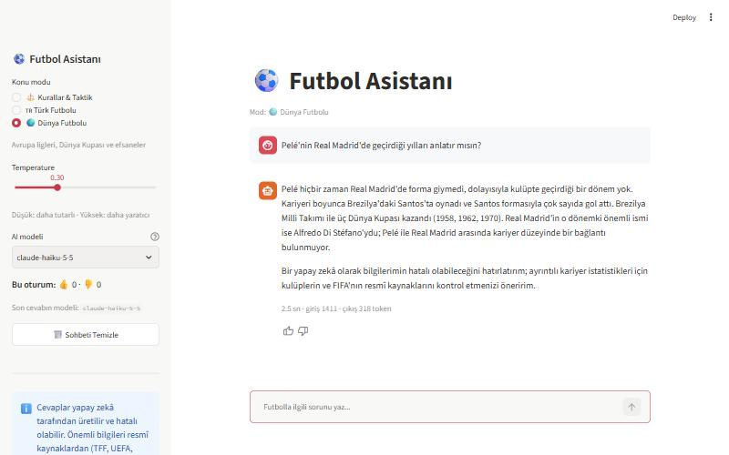

# ⚽ Futbol Asistanı

Futbol hakkındaki soruları Türkçe yanıtlayan, LLM tabanlı bir soru-cevap asistanı.
BM 445 – Üretken Yapay Zekâ ve Büyük Dil Modelleri dersi projesi.

> **Durum:** Uygulama çalışıyor. Test seti gerçek API ile çalıştırıldı (3 model, prompt v0/v1/v2, 3 temperature değeri) ve otomatik ön değerlendirmeden geçti. Sonuçlar: [04 – Test Planı, Bölüm 8–9](docs/04-test-plani.md). Rapordan önce puanların elle kontrolü ve bir eksik ölçüm (aşağıda *Bekleyen ölçüm*) kaldı.

## Özellikler

- **3 konu modu:** ⚖️ Kurallar & Taktik · 🇹🇷 Türk Futbolu · 🌍 Dünya Futbolu
- **Sohbet geçmişi:** Takip soruları sorulabilir
- **Ayarlanabilir temperature:** 0.0 (tutarlı) – 1.0 (yaratıcı)
- **Konu dışı soruları reddetme** ve güncel bilgi uyarısı
- **Güvenlik:** Prompt injection koruması, girdi doğrulama, hız sınırı
- **Kişisel bilgi uyarısı:** Telefon, T.C. kimlik no, e-posta, IBAN, kart no veya adres yazılırsa modele gönderilmeden gizlenir ve kullanıcı uyarılır
- **Geri bildirim:** Her cevaba 👍/👎
- **Süre ve token bilgisi:** Her cevabın altında gösterilir
- **Yedek model:** Ana model yanıt vermezse otomatik devreye girer
- **Otomatik test scripti:** 49 test sorusu, 3 model karşılaştırması, sonuçlar JSON/CSV olarak kaydedilir

## Kullanılan Teknolojiler

| | |
|---|---|
| Arayüz | [Streamlit](https://streamlit.io) |
| LLM | GPT-5.6 Luna, yedek Gemini 4 Argon (OpenCode Go üzerinden; arayüzden başka model seçilebilir). Seçim gerekçesi: [06 – Mimari, Bölüm 6](docs/06-mimari.md) |
| API istemcisi | `openai` Python SDK (OpenAI uyumlu API) |
| Dil | Python 3.10+ |

## Kurulum

```bash
# 1. Depoyu klonla
git clone <depo-adresi>
cd futbol-chatbot

# 2. Sanal ortam oluştur
python -m venv .venv
# Windows:
.venv\Scripts\activate
# macOS / Linux:
source .venv/bin/activate

# 3. Bağımlılıkları kur
pip install -r requirements.txt

# 4. Ortam değişkenlerini ayarla
copy .env.example .env      # Windows
cp .env.example .env        # macOS / Linux
```

`.env` dosyasını düzenle:

```bash
OPENCODE_API_KEY=buraya-anahtarinizi-yazin
LLM_BASE_URL=https://opencode.ai/zen/go/v1
LLM_MODEL=gpt-5.6-luna
LLM_MODELS=gpt-5.6-luna,gemini-4-argon,claude-haiku-5-5
LLM_FALLBACK_MODEL=gemini-4-argon
LLM_REASONING_EFFORT=low
LLM_COMPARE_MODELS=gpt-5.6-luna,gemini-4-argon,claude-haiku-5-5
```

> **Not:** OpenCode Go uç noktası (`zen/go/v1`) her istekte `x-opencode-session` başlığı ister; `llm_client.py` bunu otomatik ekler. `inference/openai/v1` adresini kullanma: oradaki istekler Go aboneliğinden değil kredi bakiyesinden düşer. DeepSeek gibi Avrupa/ABD dışında barındırılan modeller için OpenCode konsolunda *Privacy → Regions* ayarından **Global** seçilmelidir.

> `.env` dosyasını asla depoya ekleme.

## Kullanım

```bash
streamlit run app.py
```

Tarayıcıda `http://localhost:8501` açılır.

1. Sol menüden bir **konu modu** seç.
2. İstersen **temperature** değerini ayarla.
3. Sorunu yaz ya da örnek sorulardan birine tıkla.
4. Yeni bir konu için **Sohbeti Temizle** butonunu kullan.

### Örnek sorular

| Mod | Soru |
|---|---|
| ⚖️ Kurallar & Taktik | Ofsayt kuralı nedir? |
| ⚖️ Kurallar & Taktik | 4-3-3 dizilişinin güçlü ve zayıf yanları nelerdir? |
| 🇹🇷 Türk Futbolu | Türkiye 2002 Dünya Kupası'nda kaçıncı oldu? |
| 🇹🇷 Türk Futbolu | Galatasaray UEFA Kupası'nı hangi yıl kazandı? |
| 🌍 Dünya Futbolu | Premier Lig'de yenilgisiz şampiyon olan takım hangisidir? |
| 🌍 Dünya Futbolu | Johan Cruyff'un futbola katkıları nelerdir? |

### Örnek sohbet

**Dünya Futbolu** modunda yanlış varsayım içeren bir soru (halüsinasyon tuzağı). Model varsayımı düzeltiyor, cevabın altında süre/token bilgisi ve 👍/👎 butonları görünüyor:



## Testleri Çalıştırma

```bash
# Tüm testler (varsayılan: prompt v1, temperature 0.3, 3 tekrar)
python run_tests.py

# Seçenekler
python run_tests.py --mode turk_futbolu
python run_tests.py --ids KT-01,DV-01 --repeat 1
python run_tests.py --temperature 0.8
python run_tests.py --prompt-version v0

# 3 modeli karşılaştır (kör puanlama dosyasıyla)
python run_tests.py --models gpt-5.6-luna,gemini-4-argon,claude-haiku-5-5 --blind
```

Sonuçlar `tests/results/` klasörüne yazılır. Değerlendirme yöntemi için bkz. [docs/04-test-plani.md](docs/04-test-plani.md).

### Otomatik ön değerlendirme

`evaluate.py`, test çıktılarını rubriğe göre ayrı bir hakem modele (varsayılan `qwen4-max`; test edilen modellerden farklı bir aile) puanlatır ve özet tabloları üretir:

```bash
python evaluate.py tests/results/results_*_v1_*.json
```

Çıktılar: `evaluated_*.json/.csv` (soru bazında `oto_*` puanları ve gerekçeleri) ve `ozet_*.md` (metrik tabloları, kalan davranış testleri, halüsinasyon adayları). Hakem model de hata yapabileceği için bu puanlar **ön değerlendirmedir**; düşük puanlı ve halüsinasyon işaretli cevaplar elle kontrol edilmelidir.

### Bekleyen ölçüm

Gemini 4 Argon'un prompt v2 ile çalıştırılması, OpenCode Go'nun 5 saatlik kullanım sınırına takıldı. Son 12 istek (HT-02 – HT-05) cevaplanamadı ve bu çalıştırma puanlanamadı. Sınır sıfırlandıktan sonra:

```bash
python run_tests.py --prompt-version v2 --model gemini-4-argon --ids HT-02,HT-03,HT-04,HT-05
python evaluate.py "tests/results/results_*_v2_t0.3_gemini-4-argon.json" --out part3
python evaluate.py --summary-only tests/results/evaluated_part1.json tests/results/evaluated_part2.json tests/results/evaluated_part3.json --out tum_sonuclar
```

`evaluate.py` iki sonuç dosyasını aynı soru altında birleştirir; ilk dosyadaki hatalı satırlar yok sayılır. Gemini v2, GPT v2'den belirgin şekilde iyi çıkarsa ana model kararı ([04 – Bölüm 8.4](docs/04-test-plani.md)) yeniden değerlendirilmelidir.

> Tam test seti (49 soru × 3 tekrar = 147 istek) yaklaşık 5–20 dakika sürer ve aboneliğin 5 saatlik kotasından harcar. Bir oturumda 6–7'den fazla tam çalıştırma yapmamaya dikkat et.

## Klasör Yapısı

```
futbol-chatbot/
├── app.py              # Streamlit arayüzü
├── llm_client.py       # LLM API istemcisi
├── prompt_loader.py    # Sistem promptlarını yükler
├── security.py         # Girdi doğrulama, hız sınırı
├── config.py           # Ayarlar
├── run_tests.py        # Otomatik test scripti
├── evaluate.py         # Otomatik ön değerlendirme (LLM-as-judge)
├── prompts/            # Sürümlü sistem promptları (v0, v1, v2)
├── tests/              # Test soruları ve sonuçlar
└── docs/               # Proje dokümanları
```

## Dokümanlar

| Doküman | İçerik |
|---|---|
| [01 – Gereksinimler](docs/01-gereksinimler.md) | Problem, amaç ve hedefler, kapsam, gereksinimler |
| [02 – Personalar](docs/02-personalar.md) | Hedef kullanıcılar |
| [03 – Kullanıcı Senaryoları](docs/03-kullanici-senaryolari.md) | User story'ler ve senaryolar |
| [04 – Test Planı](docs/04-test-plani.md) | 49 test sorusu, rubrik, halüsinasyon analizi, model karşılaştırması |
| [05 – Sistem Promptu](docs/05-sistem-promptu.md) | Promptlar ve prompt iyileştirme deneyi |
| [06 – Mimari](docs/06-mimari.md) | Bileşenler, arayüz tasarımı, LLM seçimi |
| [07 – Güvenlik](docs/07-guvenlik.md) | Güvenlik önlemleri |
| [08 – Etik](docs/08-etik.md) | Kişisel veri, telif, yanlış bilgi, sorumlu AI |
| [09 – Rapor Şablonu](docs/09-rapor-sablonu.md) | Teknik rapor iskeleti |
| [10 – Demo Planı](docs/10-demo-plani.md) | Sunum ve demo akışı |

## Sınırlılıklar

- Model bilgisi belirli bir tarihe kadardır; güncel puan durumu ve transferler hakkında bilgi veremez.
- Cevaplar yapay zekâ tarafından üretilir ve **hatalı olabilir**. Önemli bilgileri resmî kaynaklardan (TFF, UEFA, FIFA) doğrulayın.
- Mesajlar yanıt üretmek için üçüncü taraf bir servise gönderilir; kişisel bilgi paylaşmayın.

## Lisanslar

Kullanılan kütüphaneler: Streamlit (Apache 2.0), openai-python (Apache 2.0), python-dotenv (BSD-3-Clause).
